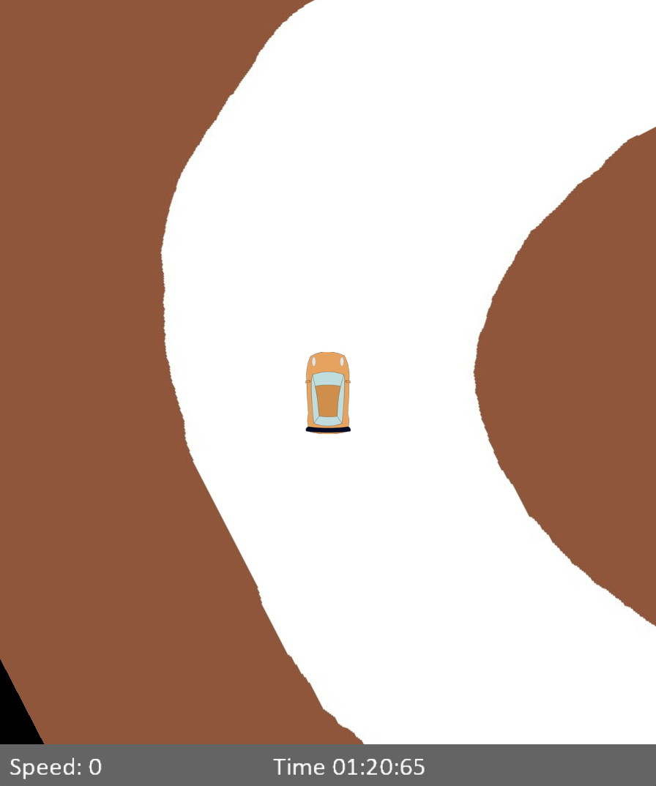

<p align="center">

</p>

This repo contains a racing game written in Python. There is a timer display, and the player attempts to control the racing automobile with keyboard forward/backward/left/right keys and finish the lap as soon as possible.

## Installation

- Python 3

```
pip install -r requirements.txt
```

## Run the app

```
python app.py
```